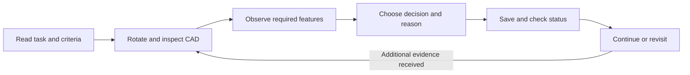
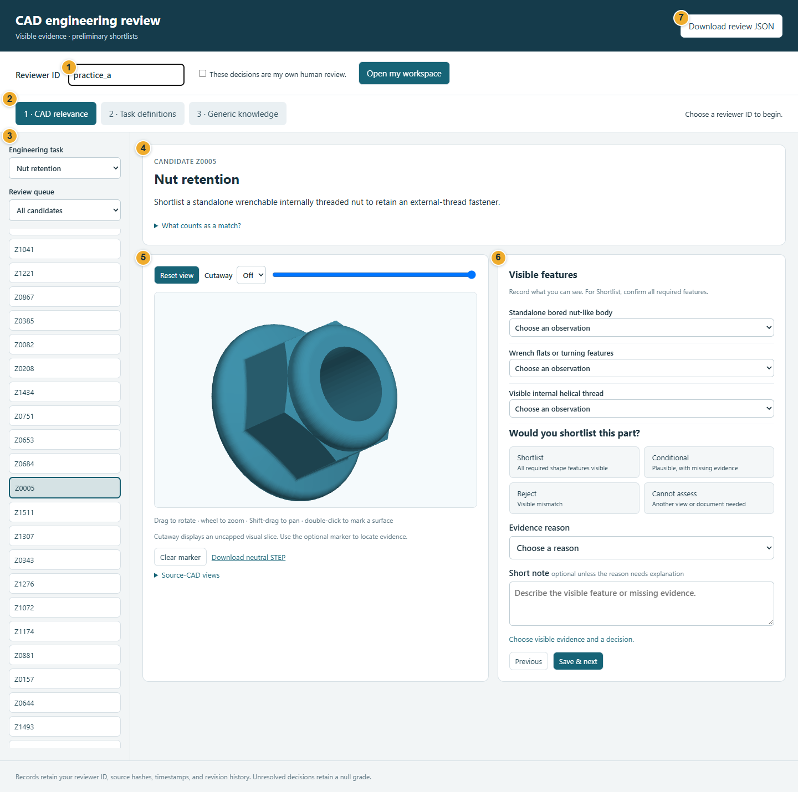
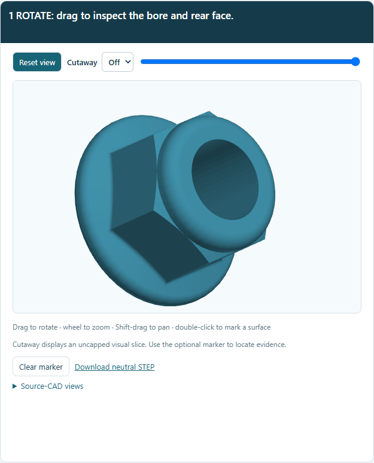
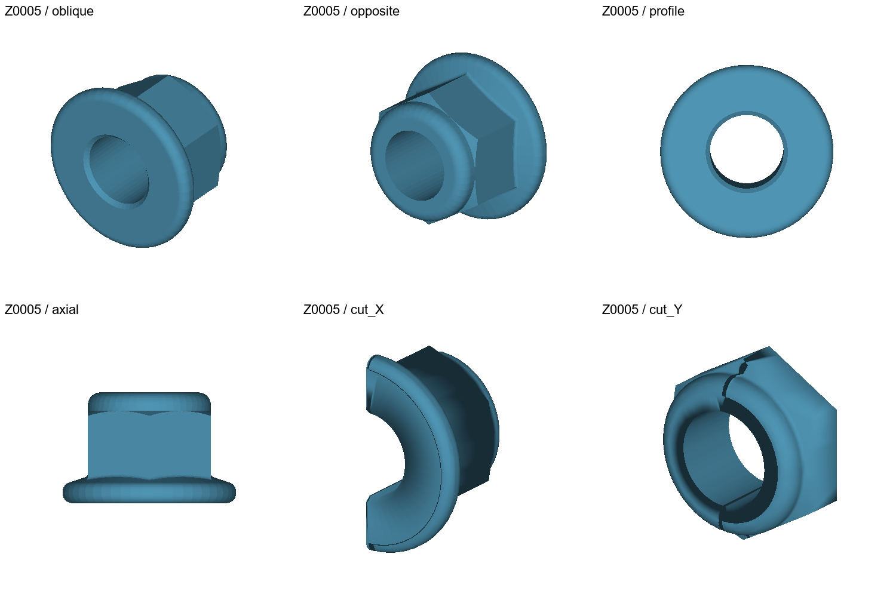
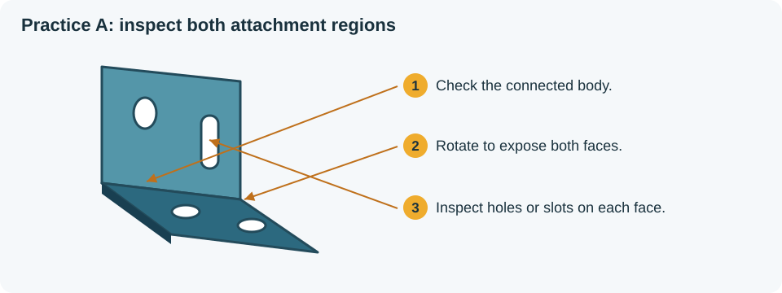
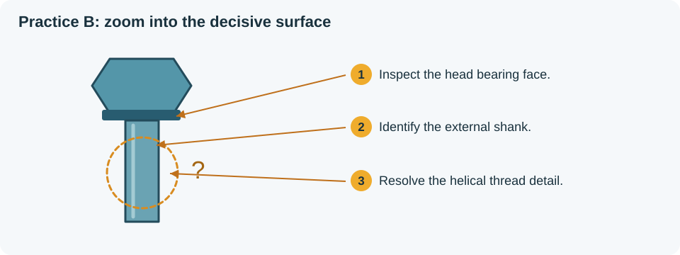
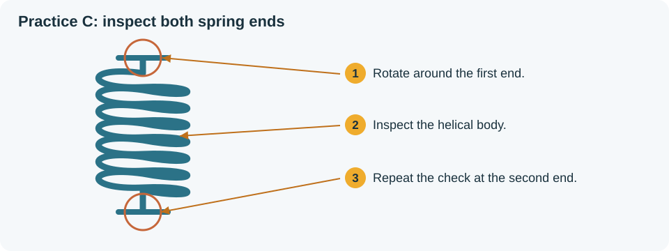
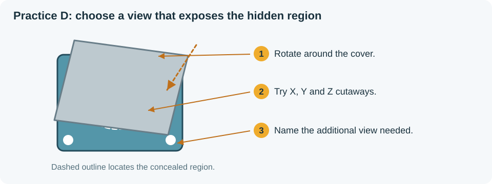

# Annotating a CAD candidate, step by step

Each annotation answers one question: **Does the candidate's visible geometry support the selected engineering role?** The app contains 1,816 candidates and eleven roles. Reviewing every candidate for every role produces 19,976 assessments.

Use the same inspection sequence for each candidate: read the request, inspect the geometry, record the required features, choose a decision, explain the evidence, and save. The examples below are practice scenarios built around the app's existing task definitions.

## Visual route through an annotation

**Figure 1. Workspace tour.** The screenshot locates the controls before opening a workspace. Follow the numbered controls in order:

| Callout | Action | What to check on screen |
|---|---|---|
| **1** | Enter your reviewer ID, attest authorship, and open the workspace | **Workspace ready** appears beside the identity controls |
| **2** | Open Task definitions, CAD relevance, or Generic knowledge | The active section is highlighted |
| **3** | Select the engineering task, queue, and candidate | The candidate ID above the viewer matches your selection |
| **4** | Read the request and expand **What counts as a match?** | Identify the features required for this role |
| **5** | Rotate, zoom, pan, and use cutaway | Expose the region that determines each feature observation |
| **6** | Select feature observations, a decision, a reason, and any note | Read the save-status message before continuing |
| **7** | Download the review JSON | Save the file with your session records |

## 1. Open your workspace

1. Enter your assigned **Reviewer ID**, for example `expert_a`.
2. Select **These decisions are my own human review**.
3. Click **Open my workspace**.
4. Check that the identity status reads **Workspace ready**.
5. Keep the same reviewer ID for later sessions. Opening that ID restores its saved decisions.

For a training session, use a separate practice ID such as `practice_a`. Use your assigned study ID when beginning the main review.

## 2. Review the task definitions

1. Click **2 · Task definitions**.
2. Select a task in the list.
3. Read the request and the Shortlist, Conditional, and Reject criteria.
4. Choose **Accept as written** when the scope and criteria are clear.
5. Choose **Request a change** when wording needs revision. Enter the proposed wording and explain the ambiguity in **Review note**.
6. Click **Save review** and check the **Saved** message.

Example task-review note:

> Please specify whether a partly concealed mounting slot satisfies the mounting-feature criterion. The slot opening is visible, but its connection to the second attachment face is unclear.

The coordinator reviews requested changes before issuing a revised protocol. The current annotation session continues to use its frozen task definitions.

## 3. Select a role and candidate

1. Click **1 · CAD relevance**.
2. Choose an **Engineering task**, such as **Fixed bracket mounting**.
3. Choose **Not reviewed** in **Review queue** to work through pending cases.
4. Select a neutral candidate ID, such as `Z0001`.
5. Read the request above the viewer.
6. Expand **What counts as a match?** and read the task criteria.

The same candidate appears under all eleven tasks. Each task has its own annotation. A candidate can support one role and conflict with another.

## 4. Inspect the source geometry

| Action | Control | What to inspect |
|---|---|---|
| Rotate | Drag on the viewer | Overall form, end geometry, attachment regions |
| Zoom | Mouse wheel | Threads, grooves, holes, keyways, and tooth profiles |
| Pan | Hold Shift while dragging | Move a small feature into a clear viewing position |
| Reset | **Reset view** | Return to the starting orientation |
| Cutaway | Select X, Y, or Z and move the slider | Concealed bore, internal seat, or passage |
| Mark evidence | Double-click a visible surface | Locate the feature described in your note |
| Remove marker | **Clear marker** | Clear a marker before placing another |
| Compare source views | Expand **Source-CAD views** | Oblique, opposite, profile, axial, and cutaway views |
| Inspect STEP | **Download neutral STEP** | Open the original geometry in your CAD viewer |

Begin with the overall form. Rotate to inspect each required region. Then zoom into the feature that determines the decision. Use cutaway when an internal region is relevant, and return Cutaway to **Off** before the final overall check.

A surface marker identifies one location in normalized source coordinates. Pair it with a note that names the feature. For example: “Marker at the slot opening on the upright mounting face.”

### Follow the viewer demonstration

**Figure 2. Six viewer actions on candidate Z0005.** The caption names the action currently shown. Repeat the sequence in a practice session:

1. **Rotate:** drag horizontally until the rear face comes into view. Follow the bore opening as the model turns.
2. **Zoom:** place the pointer over the viewer and roll the wheel. Enlarge the bore edge until its surface detail is clear.
3. **Pan:** hold Shift and drag. Move the region of interest toward the center while keeping the viewing angle.
4. **Cutaway:** select X, then move the slider slowly across the model. Watch the material disappear along the selected axis and inspect the exposed interior. Repeat with Y or Z when the first axis leaves the target concealed.
5. **Mark:** return Cutaway to Off, then double-click a visible surface. Check the red marker and its coordinate message. Name that feature in the note.
6. **Reset:** use **Clear marker** and **Reset view** to return to the overall form.

Open the [still view of the viewer controls](assets/viewer-controls.png) to keep the controls beside you while practising.

### Read the six source views

**Figure 3. Source-view inspection map.** Open **Source-CAD views** below the viewer and follow these prompts:

| View position | Inspection prompt | Next action |
|---|---|---|
| Top left: **oblique** | Where are the outer body, bore opening, and turning features? | Rotate the interactive model to examine those regions |
| Top middle: **opposite** | Which features become visible from the rear? | Compare the opposite face with the first view |
| Top right: **profile** | Where are the circular end face and bore opening? | Rotate away from this view to inspect the bore wall and the features behind the end face |
| Bottom left: **axial** | How do the body and end flanges appear from the side? | Compare their outline with the end-on view above |
| Bottom middle: **cut_X** | What interior region is exposed by the first cut? | Move the interactive X slider through the same region |
| Bottom right: **cut_Y** | What additional interior detail appears on the second axis? | Compare with Y cutaway before recording the feature observation |

Record the feature observation after combining the views. When a required detail remains unresolved, identify the detail and the additional evidence needed in the note.

## 5. Record each visible feature

Choose one observation for each listed feature:

| Observation | Use when | Example |
|---|---|---|
| **Visible** | The inspected geometry shows the required feature | A slot passes through the upright mounting face |
| **Visibly absent** | The inspected region shows a conflicting or missing feature | A fully visible spring end continues into a long torsion arm |
| **Unclear / concealed** | The available inspection leaves the feature unresolved | A cover conceals the second spring attachment |

Inspect a concealed region before marking a feature absent. When the region remains concealed, record **Unclear / concealed** and describe the view or document needed.

## 6. Choose the decision and evidence reason

| Decision | Selection rule | Grade |
|---|---|---|
| **Shortlist** | Every required visible feature supports the task | 2 |
| **Conditional** | The form is plausible and a specific requirement remains unresolved | 1 |
| **Reject** | Visible geometry conflicts with a required feature or the task scope | 0 |
| **Cannot assess** | The available evidence is insufficient to determine suitability | null |

**Conditional** records positive geometric evidence together with a named unresolved requirement. **Cannot assess** records a case where the available evidence leaves the overall assessment unresolved.

Use the closest evidence reason:

| Evidence reason | Typical use |
|---|---|
| Required shape features are visible | All required features can be identified |
| A required feature is visibly absent | Inspection shows a missing requirement |
| Visible form conflicts with the requested role | The observed form has a different attachment or motion arrangement |
| A required feature remains unverified | A plausible candidate has one unresolved requirement |
| Additional views or documentation are needed | The available evidence leaves suitability unresolved |
| Other evidence, explained in the note | The decision needs a different evidence explanation |

Write notes in this order: **observed form, decisive feature, unresolved detail or requested evidence**. Refer to a surface marker or named view when useful.

## Worked example A: Shortlist a fixed bracket

**Practice scenario:** The model has a connected L-shaped body. A pair of holes passes through its base, and a slot passes through its upright face.

**Figure 4. Three visual checks for the bracket example.** Follow callouts 1–3, then map the observed body, faces, and mounting features to the three form fields below.

1. Select **Fixed bracket mounting**.
2. Read the requirement for a fixed bracket with mounting features on two angled or offset attachment regions.
3. Rotate the model to show the base and upright face together. Inspect their connection.
4. Turn the base toward the viewer and inspect the two holes.
5. Turn the upright face toward the viewer and inspect the slot.
6. Enter the following observations:

   | Feature | Observation |
   |---|---|
   | Connected rigid mounting body | **Visible** |
   | Two angled or offset attachment regions | **Visible** |
   | Mounting holes or slots in both regions | **Visible** |

7. Choose **Shortlist**.
8. Choose **Required shape features are visible**.
9. Enter this example note:

   > Connected L-shaped body with two base holes and an elongated slot through the upright face. Both attachment regions are visible after rotation.

10. Check **Saved automatically**, then click **Save & next**.
11. Reopen the candidate from **Reviewed** and confirm that the feature selections, decision, reason, and note have been retained.

## Worked example B: Mark a headed fastener Conditional

**Practice scenario:** The model has a head with an underside bearing face and a cylindrical external shank. The shank is represented by a smooth surface, leaving its thread requirement unresolved.

**Figure 5. Locate the unresolved surface.** Inspect the head and shank first. Zoom into the circled region, compare another orientation, and record the thread observation using the task's written criterion.

1. Select **Headed threaded clamping**.
2. Rotate the head to inspect the underside bearing surface.
3. Zoom into the shank and inspect it from multiple directions.
4. Compare the source views. If helpful, open the STEP file in a CAD viewer to inspect the shank surface.
5. Enter:

   | Feature | Observation |
   |---|---|
   | Fastener head with a bearing surface | **Visible** |
   | External shank | **Visible** |
   | Visible external helical thread | **Unclear / concealed** |

6. Choose **Conditional**.
7. Choose **A required feature remains unverified**.
8. Enter:

   > Head bearing face and external shank are visible. The shank uses a smooth representation; external thread geometry remains unresolved. A detailed thread model or drawing would resolve this requirement.

9. Check the save status and click **Save & next**.

This task's Conditional criterion specifically covers a headed shank with a simplified smooth thread representation. Apply that written criterion when interpreting the smooth surface.

## Worked example C: Reject a compression coil for tension return

**Practice scenario:** The model is an open helical coil. Both ends are fully exposed and finish as axial seating ends.

**Figure 6. Check both attachment regions.** Rotate to expose the first end, inspect the coil body, and repeat the end check on the opposite side. Use the observed end geometry when assessing the tension-return requirement.

1. Select **Axial tension return spring**.
2. Read the requirement for a helical body with two opposed hooks or loops.
3. Rotate to inspect the first end, then the second end.
4. Inspect the axial source view to check both attachment regions.
5. Enter:

   | Feature | Observation |
   |---|---|
   | Helical coil body | **Visible** |
   | Two opposed hooks or loops | **Visibly absent** |
   | Ends form tensile attachment regions rather than torsion arms | **Visibly absent** |

6. Choose **Reject**.
7. Choose **A required feature is visibly absent**.
8. Enter:

   > Open helical coil with two fully visible axial seating ends. Both ends lack the hooks or loops required for tensile attachment.

9. Check the save status and continue.

When reviewing the same candidate under **Axial compression spring**, inspect its coil travel and seating ends against that task's feature list and record a separate decision.

## Worked example D: Record Cannot assess for concealed support geometry

**Practice scenario:** An assembly contains a partly visible housing. Surrounding components conceal the central support region and its connection to the mounting body. Rotation and the available cutaways leave that relationship unresolved.

**Figure 7. Investigate a concealed region.** Follow the cover boundary while rotating, then sweep cutaway through the target on each axis. Describe the remaining concealed relationship and name the view that would expose it.

1. Select **Mountable shaft support**.
2. Inspect the overall assembly and locate the possible housing.
3. Rotate around the central region and try the X, Y, and Z cutaways.
4. Compare the six source views and inspect the STEP assembly where available.
5. Record the visible and unresolved features:

   | Feature | Observation |
   |---|---|
   | Stationary carrier or housing body | **Unclear / concealed** |
   | Circular shaft-support seat | **Unclear / concealed** |
   | Mounting or attachment features | **Visible**, if mounting holes are exposed |

6. Choose **Cannot assess**.
7. Choose **Additional views or documentation are needed**.
8. Enter:

   > Mounting holes are visible on the outer body. Surrounding components conceal the support seat and its connection to the housing. An exploded assembly view or an isolated housing model would resolve the assessment.

9. Save the record.
10. Select **Cannot assess / revisit** to find the case later. After receiving the additional evidence, reopen the candidate, revise the observations and decision, and save. The record retains the earlier decision in its revision history.

## 7. Review generic knowledge

1. Click **3 · Generic knowledge**.
2. Select a class–function relation.
3. Read **Scope** and **Limitations**.
4. Click **Open supporting source** and inspect the cited information.
5. Choose **Accept as written**, **Request a change**, **Reject**, or **Cannot assess**.
6. For a change request, rejection, or unresolved case, explain the relevant scope or evidence in **Review note**.
7. Click **Save review**.

Example change request:

> Restrict this relation to helical extension springs with two tensile attachment regions. Add a scope sentence that distinguishes the extension configuration from compression and torsion configurations.

Knowledge review records a generic relation. CAD relevance records a particular candidate's suitability for a selected task. The app exports these review sections separately.

## 8. Finish and resume a session

1. Check the current candidate's save status.
2. Save any open task-definition or knowledge review with **Save review**.
3. Click **Download review JSON** and save the file with your session records.
4. At the next session, enter the same reviewer ID and reopen the workspace.
5. Use **Not reviewed** to continue pending work and **Cannot assess / revisit** to revisit unresolved cases.

The progress indicator counts saved CAD decisions across all roles. Each role contains 1,816 candidates. A complete review contains 19,976 saved task–candidate decisions, with unresolved cases identifiable through their decision and revisit queue.

## 9. Coordinate an independent pilot and adjudication

Ask two reviewers to inspect the same 20–30 pilot cases using separate IDs. Compare the saved decisions with the command in the README. Discuss feature interpretation, task wording, and missing views. Record agreed instruction changes before expanding the study.

During adjudication, retain both independent reviewer records and save the resolved assessment under an adjudicator ID. Include the decisive observation and the evidence that resolved the disagreement in the note.
