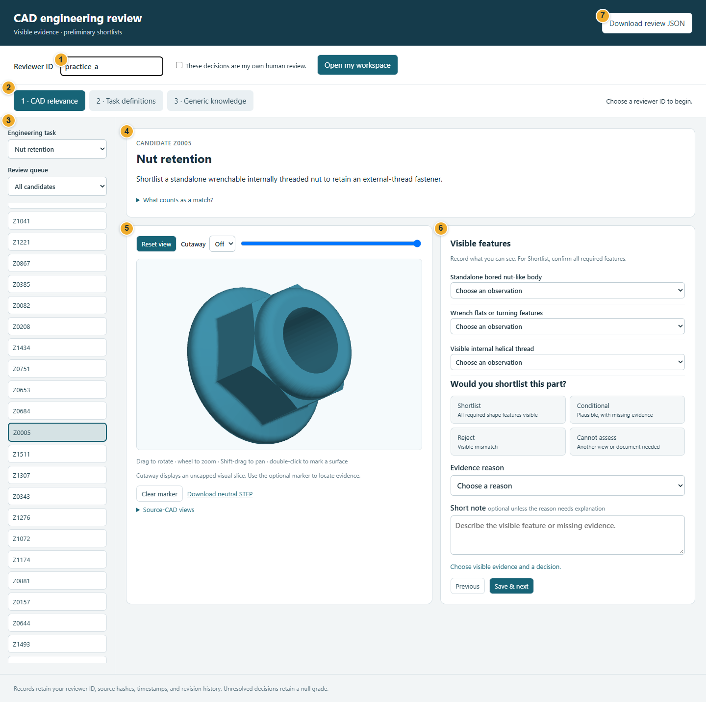
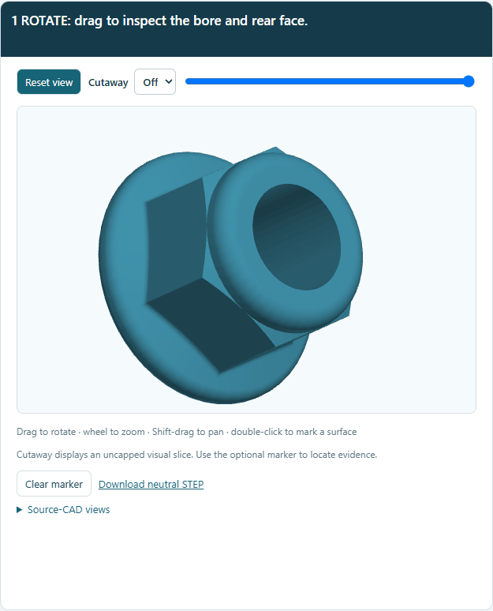
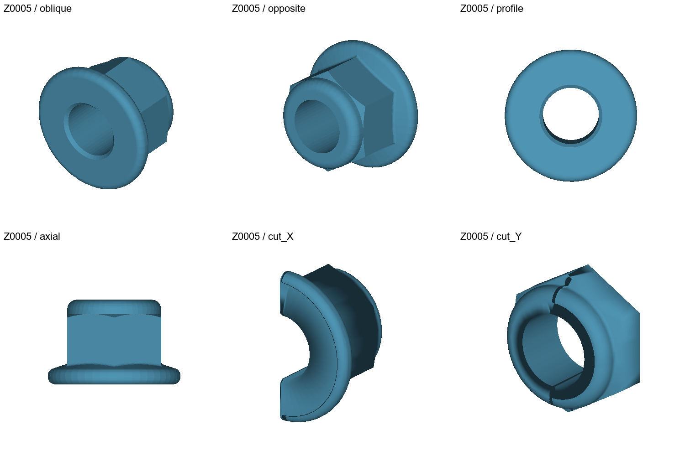
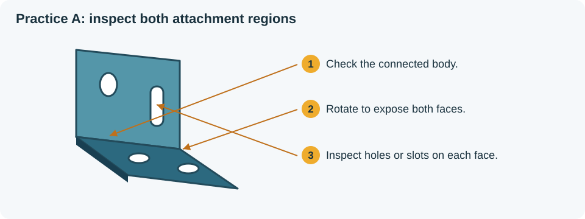
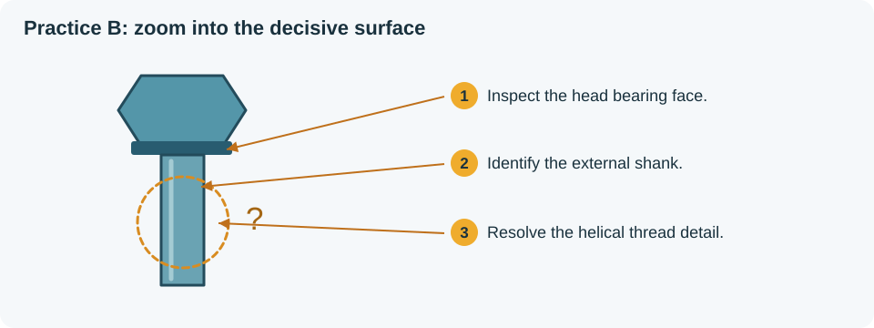
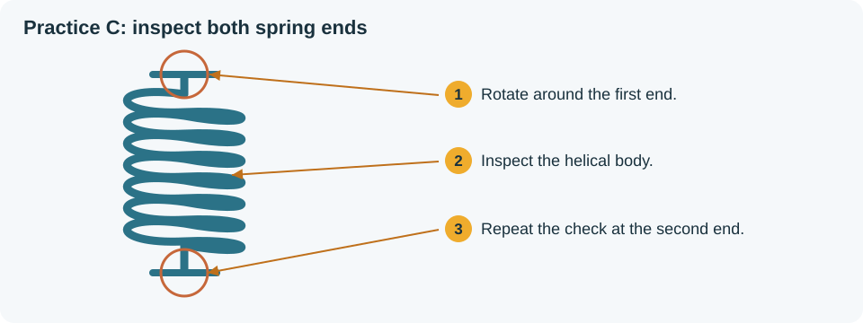
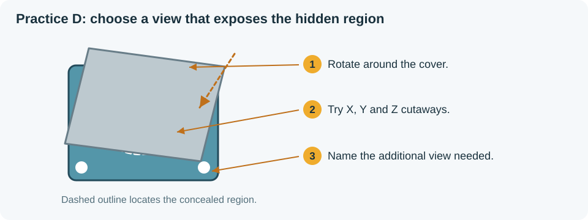

# CAD Expert Review: a guide for reviewers

Open [CAD Expert Review](https://cad-expert-review.vercel.app/) to begin.

The app lets you inspect a computer-aided design (CAD) model and judge whether its visible features support a specified engineering role. Each assessment combines a candidate, a task, your feature observations, and a decision. The review collection contains 1,816 candidates across eleven roles, giving 19,976 possible task–candidate assessments. Work through the roles and candidates assigned by your coordinator.

For your first session, follow the workspace tour, practise the viewer controls, and complete one candidate from inspection to saving.

## 1. Open your reviewer workspace

1. Enter your assigned **Reviewer ID**.
2. Select **These decisions are my own human review**.
3. Click **Open my workspace**.
4. Look for **Workspace ready** beside these controls.

Keep the same ID for future sessions. Opening that ID restores your saved reviews. **Team progress** at the top of the left sidebar shows overall coverage and an anonymous count of saved assessments per reviewer. Each candidate shows how many experts have reviewed it, and **Not reviewed by anyone** in **Review queue** lists uncovered candidates. Other reviewers' decisions and notes are never shown. Use a separate practice ID, agreed with your coordinator, when learning the controls.

### Find your way around the screen

**Figure 1. Workspace tour.** The screenshot shows the controls before opening a workspace. Use the numbered callouts to locate each area.

| Callout | Screen area | What you do here |
|---|---|---|
| **1** | Reviewer identity | Enter your ID and open your workspace |
| **2** | Review sections | Switch between task definitions, CAD relevance, and generic knowledge |
| **3** | Task and candidate list | Choose an engineering task, filter the queue, and select a candidate |
| **4** | Request and criteria | Read the selected task and expand **What counts as a match?** |
| **5** | Geometry viewer | Inspect the model, compare source views, and place an optional marker |
| **6** | Annotation form | Record features, choose a decision and reason, write a note, and check saving |
| **7** | Download | Save a copy of your reviews with **Download review JSON** |

The three review sections answer different questions:

| Section | Question |
|---|---|
| **2 · Task definitions** | Are the request and decision criteria clear? |
| **1 · CAD relevance** | Does this candidate's geometry support this task? |
| **3 · Generic knowledge** | Is the stated relationship between a part category and a function appropriate within its scope? |

## 2. Read the task before inspecting candidates

1. Click **2 · Task definitions** and select an assigned task.
2. Read its **Request** and the **Shortlist**, **Conditional**, and **Reject** criteria.
3. Choose **Accept as written** when the wording is clear. Choose **Request a change** to propose revised wording, **Reject** to record disagreement, or **Cannot assess** when you need further information.
4. For a change request, rejection, or unresolved assessment, explain your reason in **Review note**.
5. Click **Save review** and check for **Saved**.

For example, a task-review note could read:

> Please clarify whether a partly concealed mounting slot meets the attachment criterion. Its opening is visible, but its connection to the second face remains unclear.

The coordinator receives this note. Continue using the task criteria shown in the app.

## 3. Choose a candidate

1. Click **1 · CAD relevance**.
2. Select an assigned **Engineering task**.
3. Set **Review queue** to **Not reviewed**.
4. Click a candidate ID in the list on the left.
5. Read the request above the model and expand **What counts as a match?**.

A candidate ID identifies a model. The selected task determines which features you assess. The same model has a separate review under each role, so read the request whenever you change tasks.

## 4. Inspect the model visually

Start with the overall shape. Rotate to expose each required region, then zoom into the feature that determines your decision. Compare several viewing directions before recording an observation.

**Figure 2. Practise six viewer actions.** Follow the caption in the animation, then repeat each action in your practice workspace.

| Action | How to operate it | What to look for |
|---|---|---|
| **Rotate** | Drag across the model | Inspect the front, rear, ends, and attachment regions |
| **Zoom** | Roll the mouse wheel over the viewer | Enlarge a hole, slot, thread, groove, or tooth profile |
| **Pan** | Hold **Shift** and drag | Bring the feature of interest toward the centre |
| **Cutaway** | Select **X**, **Y**, or **Z**, then move the slider | Sweep through the body to expose an internal region |
| **Mark a surface** | Double-click a visible surface | Place the red marker on the feature described in your note |
| **Reset** | Click **Clear marker** and **Reset view** | Return to an overall inspection of the candidate |

For cutaway, move the slider slowly across the target region. Try another axis when you need a clearer opening. The cutaway exposes surfaces along the chosen direction. Return **Cutaway** to **Off** before your final overall check.

After placing a marker, name the marked feature in **Short note**. For example: “Marker at the slot opening on the upright mounting face.” Use **Clear marker** to remove it before marking another location.

You can keep the [still image of the viewer controls](../assets/viewer-controls.png) open beside the app while practising.

### Compare the source views

Expand **Source-CAD views** below the interactive model.

**Figure 3. Inspect one feature across several views.** Use the image labels and positions to follow this sequence.

| Position and label | Inspection step |
|---|---|
| Top left, **oblique** | Locate the outer body, opening, and turning features |
| Top middle, **opposite** | Check the rear face and compare it with the first view |
| Top right, **profile** | Inspect the circular end face and bore entrance shown here |
| Bottom left, **axial** | Compare the side outline of the body and its end flanges |
| Bottom middle, **cut_X** | Inspect the interior exposed by the first cut |
| Bottom right, **cut_Y** | Compare the interior from the second cut direction |

Use **Download neutral STEP** when you want to inspect the original model in a CAD viewer. STEP is the downloadable geometry file for the selected candidate.

## 5. Record features and choose a decision

Under **Visible features**, select an observation for each listed requirement.

| Observation | When to choose it |
|---|---|
| **Visible** | The inspected geometry shows the required feature |
| **Visibly absent** | The relevant region is exposed and the required feature is absent or conflicts with the criterion |
| **Unclear / concealed** | Further inspection or documentation is needed to resolve the feature |

Then choose the assessment under **Would you shortlist this part?**

| Decision | How to apply it |
|---|---|
| **Shortlist** | Every required visible feature supports the task |
| **Conditional** | The candidate has supporting geometry and a specific requirement remains unresolved |
| **Reject** | Visible geometry conflicts with a required feature or the task criteria |
| **Cannot assess** | The available evidence leaves the overall assessment unresolved |

Read the selected task's criteria when distinguishing **Conditional** from **Cannot assess**. For Conditional, identify the supporting geometry and name the unresolved requirement. For Cannot assess, describe the evidence needed to reach an overall decision.

Choose the closest **Evidence reason**:

| Reason shown in the app | Use it to explain |
|---|---|
| **Required shape features are visible** | The visible features supporting your Shortlist decision |
| **A required feature is visibly absent** | The exposed requirement that is missing |
| **Visible form conflicts with the requested role** | The geometric arrangement that conflicts with the task |
| **A required feature remains unverified** | The specific unresolved requirement of a plausible candidate |
| **Additional views or documentation are needed** | The evidence needed to complete the assessment |
| **Other evidence, explained in the note** | A different observation supporting the decision |

Write a **Short note** in this order: observed form, decisive feature, and any further evidence needed. Refer to a source view or surface marker when helpful.

### Example A: Shortlist a fixed bracket

**Figure 4. Inspect both attachment faces.** This practice example has an L-shaped body, two base holes, and an upright slot.

1. Select **Fixed bracket mounting**.
2. Rotate the model to show the connected body and both faces.
3. Turn the base toward you and inspect its holes. Then turn the upright face toward you and inspect its slot.
4. Record **Visible** for **Connected rigid mounting body**, **Two angled or offset attachment regions**, and **Mounting holes or slots in both regions**.
5. Choose **Shortlist** and **Required shape features are visible**.
6. Add a note such as:

   > Connected L-shaped body with two base holes and an elongated slot through the upright face. Both attachment regions are visible after rotation.

7. Check **Saved automatically**, then click **Save & next**.

### Example B: Mark a headed fastener Conditional

**Figure 5. Locate the unresolved thread detail.** This practice example has a head and shank, with a smooth representation of the shank surface.

1. Select **Headed threaded clamping**.
2. Rotate to inspect the underside of the head. Zoom into the shank and compare several directions.
3. Record **Visible** for **Fastener head with a bearing surface** and **External shank**.
4. Record **Unclear / concealed** for **Visible external helical thread**, following this task's criterion for simplified smooth thread representations.
5. Choose **Conditional** and **A required feature remains unverified**.
6. Explain the unresolved detail:

   > Head bearing face and external shank are visible. The shank uses a smooth representation; external thread geometry remains unresolved. A detailed thread model or drawing would resolve this requirement.

7. Check the save status, then continue with **Save & next**.

### Example C: Reject a compression coil for tension return

**Figure 6. Check both spring ends.** This practice example has a helical body with fully exposed axial seating ends.

1. Select **Axial tension return spring** and read its requirement for opposed hooks or loops.
2. Rotate to expose each end and inspect its attachment geometry.
3. Record **Visible** for **Helical coil body**.
4. Record **Visibly absent** for **Two opposed hooks or loops** and **Ends form tensile attachment regions rather than torsion arms**.
5. Choose **Reject** and **A required feature is visibly absent**.
6. Explain the decisive observation:

   > Open helical coil with two fully visible axial seating ends. Both ends lack the hooks or loops required for tensile attachment.

7. Check the save status and continue. Assess the same model separately against its feature list if assigned **Axial compression spring**.

### Example D: Record Cannot assess for a concealed support

**Figure 7. Follow the concealed region.** This practice example has exposed mounting holes while surrounding components conceal the support seat and its connection to the housing.

1. Select **Mountable shaft support**.
2. Rotate around the central region, sweep the X, Y, and Z cutaways, and compare the source views.
3. Record **Unclear / concealed** for **Stationary carrier or housing body** and **Circular shaft-support seat** when their relationship remains unresolved.
4. Record **Visible** for **Mounting or attachment features** when the mounting holes are exposed.
5. Choose **Cannot assess** and **Additional views or documentation are needed**.
6. Name the evidence that would resolve the assessment:

   > Mounting holes are visible on the outer body. Surrounding components conceal the support seat and its connection to the housing. An exploded assembly view or an isolated housing model would resolve the assessment.

7. Save the assessment. Find it later through **Cannot assess / revisit**.

## 6. Save, check, and revise your work

CAD assessments save automatically once the decision, evidence reason, and required observations or notes are complete. Watch the message below **Short note**:

| Message | What to do |
|---|---|
| **Unsaved changes** | Complete the form and wait for the save result |
| **Saved automatically** | Continue with **Save & next** |
| **Saved review loaded** | Inspect or revise the assessment you reopened |
| A message requesting an observation or explanation | Complete the named field and use **Save & next** to retry |
| A message reporting a save failure | Keep the page open, retain your note, and retry **Save & next**; contact the coordinator if the problem continues |

To check a saved assessment, select **Reviewed** in **Review queue** and reopen the candidate. Confirm its feature observations, decision, reason, and note. To revise it, edit the relevant fields and check the save status again. The record retains earlier saved decisions in its history.

Use the queues to organise your session:

| Queue | What it contains |
|---|---|
| **All candidates** | Every candidate for the selected task |
| **Not reviewed** | Candidates with a pending assessment |
| **Reviewed** | Candidates with a saved assessment, including Cannot assess |
| **Cannot assess / revisit** | Saved cases awaiting further evidence |

The progress indicator counts saved CAD assessments across all roles. An unresolved case with a saved **Cannot assess** decision appears in both the reviewed and revisit queues.

## 7. Review generic knowledge

A generic knowledge entry describes a relationship between a part category and an engineering function. Review the scope of that relationship and its supporting source.

1. Click **3 · Generic knowledge** and select an assigned entry.
2. Read **Scope** and **Limitations**.
3. Click **Open supporting source** and inspect the cited information.
4. Choose **Accept as written**, **Request a change**, **Reject**, or **Cannot assess**.
5. Explain a change request, rejection, or unresolved assessment in **Review note**.
6. Click **Save review** and check for **Saved**.

For example:

> Restrict this relation to helical extension springs with two tensile attachment regions. Add a scope sentence that distinguishes the extension configuration from compression and torsion configurations.

Task-definition and generic-knowledge reviews use the **Save review** button. Save each entry before selecting the next one.

## 8. Finish your session and return later

1. Check the save status of your current CAD assessment.
2. Save any open task-definition or generic-knowledge review with **Save review**.
3. Click **Download review JSON** at the top of the page. JSON is the downloaded record of your reviews.
4. Keep the file with your session records and share it with the coordinator as requested.
5. When you return, enter the same reviewer ID, select the authorship checkbox, and click **Open my workspace**.
6. Choose your assigned task and **Not reviewed** to continue. Use **Cannot assess / revisit** for cases with new evidence.

Before closing the app, check that your latest assessment is saved and your review download is complete.
